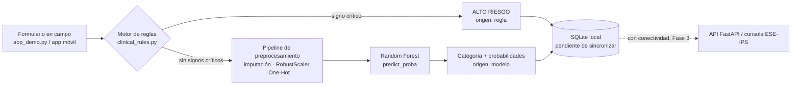

# MATERNA — Sistema de Alerta Temprana de Riesgo Materno-Perinatal

**Zonas dispersas y comunidades indígenas de La Guajira y Cesar**
Proyecto de aula · Inteligencia Artificial · Ingeniería de Sistemas, 7.º semestre · Universidad Popular del Cesar (UPC) · 2026

Equipo: Anyelin Cecilia Ospino Rueda · Duan Andrés Pineda Corrales · Rigoberto Márquez Fernández
Docente: Tony Jiménez

> ⚠️ **Prototipo académico.** Los modelos se entrenaron con un dataset **sintético** (1.200 registros) que el equipo calibró con proporciones del DANE y del INS. No contiene historias clínicas reales y **no debe usarse para tomar decisiones clínicas.**

---

## 1. ¿Qué hace?

Clasifica a una gestante en **Bajo, Medio o Alto Riesgo** obstétrico a partir de datos que se pueden tomar en un puesto de salud rural: edad, edad gestacional, controles previos, presión arterial, frecuencia cardiaca fetal, glucosa, proteinuria en tira y convulsiones. El sistema es **híbrido**:

1. Un **motor de reglas clínicas** marca de inmediato Alto Riesgo si hay PAS ≥ 160, PAD ≥ 110, convulsiones o proteinuria ++. La regla prevalece sobre el modelo.
2. Si no hay signos críticos, decide un **modelo de aprendizaje automático**: Random Forest, seleccionado en validación. La Regresión Logística es el baseline y el SVM queda como modelo de comparación.

## 2. Arquitectura



Pipeline de entrenamiento (todo lo que aprende de los datos se ajusta **solo** con entrenamiento o con cada fold):

```
CSV crudo ─► limpieza estructural ─► partición estratificada 70/15/15
                                          │
              train ──► [ imputación estratificada ─► RobustScaler + One-Hot ─► SMOTE | class_weight ─► modelo ]
                         └──────────────── GridSearchCV, 5-fold estratificado ─────────────────┘
              val   ──► selección del modelo del sistema híbrido
              test  ──► evaluación final (una sola vez)
```

## 3. Estructura del repositorio

```
MATERNA/
├── app_demo.py                      # Interfaz Streamlit (demo de sustentación, offline-first)
├── static/logo_materna.*            # Logo de la pantalla de bienvenida (servido localmente)
├── requirements.txt
├── pytest.ini
├── tests/                           # 129 pruebas automatizadas (ver sección 6)
├── data/
│   ├── raw/dataset_riesgo_materno_guajira_cesar.csv
│   └── processed/                   # Particiones train/val/test (se regeneran, no se versionan)
├── src/
│   ├── config.py                    # Rutas, semilla y definición de variables
│   ├── data_preprocessing.py        # Sub-fase 2.1
│   ├── train_models.py              # Sub-fase 2.2
│   ├── clinical_rules.py            # Sub-fase 2.3: evaluar_riesgo_hibrido()
│   ├── evaluate.py                  # Sub-fase 2.4
│   └── ui_theme.py                  # Estilo visual de la app y pantalla de bienvenida (offline)
├── models/                          # Modelos entrenados (.joblib) y metadatos
├── notebooks/
│   ├── EDA_Riesgo_Materno_Guajira_Cesar.ipynb       # EDA corregido de la Fase 1
│   └── Fase2_Modelado_y_Evaluacion_MATERNA.ipynb    # Notebook de la Fase 2
├── reports/
│   ├── metrics/                     # CSV/JSON con todas las métricas y experimentos
│   └── figures/                     # Matrices de confusión, ROC, comparación
├── docs/                            # Documento técnico de avance (Fase 2)
└── contexto/                        # Documentos de la Fase 1 y guías de la asignatura
```

## 4. Instalación y ejecución

```bash
python -m venv .venv
# Windows: .venv\Scripts\activate   ·   Linux/Mac: source .venv/bin/activate
pip install -r requirements.txt

python -m src.data_preprocessing   # 2.1 reporte de calidad y particiones
python -m src.train_models         # 2.2 búsqueda de hiperparámetros (~2 min) y modelos
python -m src.evaluate             # 2.4 métricas, figuras y auditoría de sesgos
streamlit run app_demo.py          # 2.3 demo interactiva (http://localhost:8501)

pytest                             # las 129 pruebas, incluidas las 6 de navegador (~1,5 min; requiere Google Chrome)
pytest -m "not e2e"                # 123 pruebas, sin navegador
pytest -m e2e                      # solo las 6 pruebas en Chrome real
```

Los modelos ya entrenados vienen en `models/`, así que la demo funciona sin reentrenar. Todo es reproducible con la semilla 42.

## 5. Resultados (conjunto de prueba, n = 180, de los cuales 23 son Alto Riesgo)

| Sistema | Accuracy | F1-macro (IC 95 %) | ROC-AUC OvR | Recall Alto (IC 95 %) | FN Alto | Costo clínico* |
|---|---|---|---|---|---|---|
| Regresión Logística (baseline) | 0,722 | 0,724 [0,64–0,79] | 0,854 | 0,870 [0,70–1,00] | 3 | 99 |
| SVM RBF calibrado | 0,856 | 0,846 [0,78–0,90] | 0,961 | 0,783 [0,59–0,94] | 5 | 54 |
| Random Forest | 0,961 | 0,943 [0,89–0,98] | 0,988 | 0,870 [0,71–1,00] | 3 | 19 |
| Híbrido (RL + reglas) | 0,733 | 0,742 [0,67–0,80] | 0,864 | 0,957 [0,85–1,00] | 1 | 89 |
| Híbrido (SVM + reglas) | 0,878 | 0,886 [0,83–0,93] | 0,972 | 0,957 [0,85–1,00] | 1 | 34 |
| **Híbrido (Random Forest + reglas)** | **0,972** | **0,963 [0,92–0,99]** | **0,998** | **0,957 [0,86–1,00]** | **1** | **9** |

\*Matriz de costo ilustrativa que penaliza la subestimación del riesgo (Alto→Bajo = 10, Alto→Medio = 5, Medio→Bajo = 3; la sobreestimación cuesta 1–2). Ningún sistema clasificó un Alto Riesgo como Bajo.

**Desempeño sin signos críticos** (166 casos de prueba donde no actúa ninguna regla, que es el aporte real del modelo): Random Forest F1-macro 0,932; SVM 0,847; Regresión Logística 0,673.

Validación cruzada (5-fold, entrenamiento), F1-macro:

- Random Forest (300 árboles, sin límite de profundidad, 50 % de variables por división, SMOTE): 0,932 ± 0,017.
- SVM RBF (C = 100, γ = scale, class_weight): 0,861 ± 0,011.
- Regresión Logística (C = 10, class_weight): 0,750 ± 0,013.

El sistema principal se eligió con el conjunto de validación (F1-macro del híbrido RF: 0,944). El registro de las 166 configuraciones está en `reports/metrics/experimentos_cv_completo.csv`.

## 6. Decisiones técnicas y correcciones

| Tema | Decisión | Motivo |
|---|---|---|
| SMOTE | Dentro de cada fold (`imblearn.Pipeline`) | Aplicarlo antes de la validación cruzada filtraría información sintética de los folds de validación. |
| SMOTE vs. `class_weight` | Se comparan como alternativas en cada modelo (gana SMOTE en RF y `class_weight` en SVM y RL) | Usarlos juntos compensaría el desbalance dos veces. |
| Random Forest como modelo principal | Se agregó después de las pruebas de coherencia clínica | El SVM clasificaba como Bajo Riesgo casos con un solo factor de riesgo (PA 140/90, glucosa 140, 0 controles, edad 36) y con 20 controles extrapolaba a Alto Riesgo. Los árboles representan umbrales de forma nativa y no extrapolan fuera del rango de entrenamiento. |
| Probabilidades del SVM | `CalibratedClassifierCV` (Platt) | `SVC(probability=True)` está deprecado en scikit-learn 1.9. |
| Regresión Logística | `solver='lbfgs'` sin `multi_class` | El parámetro se eliminó; lbfgs ya es multinomial. |
| Imputación | Mediana por **área × trimestre** + indicador `*_no_disponible` | Es lo que definió el documento de la Fase 1; la FCF depende fisiológicamente de la edad gestacional. Con municipio × grupo de edad, 10 de los 24 estratos tenían menos de 10 valores en entrenamiento (Becerril ≥ 35 años: 1), y la mediana resultaba inestable. |
| Variables demográficas | Etnia, municipio y departamento **no** entran al modelo | No mejoran a ningún modelo en la ablación (RF 0,932 → 0,930; SVM 0,861 → 0,828) y evitan que la identidad étnica funcione como *proxy* de riesgo. Se usan para auditar sesgos. |
| Selección | F1-macro en CV; modelo híbrido elegido en validación | La prueba se usa solo para el informe final. |
| Imputación con enteros | La columna se convierte a `float` antes de imputar | Bug encontrado en las pruebas: `glucosa=100` (entero, sin nulos) hacía fallar la imputación con pandas 3. |

### Pruebas automatizadas (`tests/`)

| Archivo | Qué verifica | Pruebas |
|---|---|---|
| `test_reglas_clinicas.py` | Umbrales exactos (159/160, 109/110, proteinuria 1/2), valores faltantes, versión vectorizada igual a la individual, y que 2.000 entradas aleatorias con signo crítico terminen siempre en Alto | 27 |
| `test_preprocesamiento.py` | Carga, partición 70/15/15 disjunta y reproducible, imputación sin fuga, respaldo con estratos pequeños y categorías desconocidas | 12 |
| `test_modelos.py` | Probabilidades válidas, determinismo, 5.000 entradas aleatorias del formulario, valores en los bordes, invariancia a etnia y territorio, métricas reproducibles | 37 |
| `test_coherencia_clinica.py` | Un solo factor de riesgo no puede dar Bajo Riesgo; sin extrapolación absurda fuera de rango | 17 |
| `test_app.py` | Cada entrada del formulario, umbrales desde la interfaz, valores extremos, cambio de modelo, guardado y sincronización, bienvenida solo al abrir | 30 |
| `test_e2e_navegador.py` | Pantalla de bienvenida (logo centrado, desvanecimiento y retiro), flujo completo en Chrome, escritura en el formulario, ausencia de errores de JavaScript (`pytest -m e2e`) | 6 |

Correcciones a la Fase 1 (detalle en el notebook de EDA):
- El EDA entregado analizaba el dataset UCI y no el propio. Ahora el EDA usa el dataset de La Guajira y Cesar.
- Las conclusiones de ese notebook contradecían sus salidas (duplicados y umbral de desbalance).
- Los nulos **no** se concentran en el área rural en la glucosa (cabecera 14,2 %, rural 12,6 %).
- Se elimina la columna vacía `Unnamed: 16` que genera la coma final del CSV.
- Errores de digitación en el cronograma: "Blatter" → Flutter, "Fasta PI" → FastAPI, "F1/Real" → F1/Recall.

## 7. Limitaciones, ética y sesgos

- **Etiquetas sintéticas por reglas.** Las 89 gestantes con signos críticos están todas etiquetadas como Alto Riesgo, porque las etiquetas se generaron con esos umbrales. El híbrido acierta esos casos por construcción. Las métricas miden la capacidad de reproducir el etiquetado, no el desempeño clínico.
- **Ventaja de los árboles sobre datos sintéticos.** Las etiquetas siguen umbrales, y eso es justo lo que los árboles aprenden mejor. Parte de la ventaja del Random Forest puede deberse a esa estructura y achicarse con datos reales.
- **Brecha por subgrupo.** Con el Random Forest, el recall de Alto Riesgo en el área rural dispersa subió de 0,78 a 0,88, pero sigue por debajo de la cabecera (0,94). El subgrupo más bajo es la atención por auxiliar de enfermería (0,64, con solo 11 casos de Alto Riesgo). Ver `reports/metrics/auditoria_subgrupos.csv`.
- **Casos para el asesor clínico.** Con FCF 60 o glucosa 300, el modelo da solo Riesgo Medio, aunque clínicamente podrían ser una emergencia. No se convirtieron en reglas porque los umbrales debe definirlos un especialista.
- **Incertidumbre.** Con 23 casos de Alto Riesgo en prueba, los intervalos de confianza son amplios.
- **Protocolos.** Los textos de acción de la app son orientativos y deben validarse con un ginecobstetra y con la red de referencia de cada ESE/IPS.
- **Idioma.** La interfaz en Wayuunaiki necesita una traducción validada con la comunidad; no se inventa.

## 8. Hoja de ruta (Fase 3)

API FastAPI documentada · app móvil Flutter offline (SQLite) con exportación del modelo · ajuste de umbrales orientado al recall en subgrupos rurales · reglas para bradicardia fetal e hiperglucemia severa validadas por un especialista · validación con datos reales anonimizados mediante una alianza con una ESE/IPS · informe final con análisis ético.

## 9. Flujo de trabajo con Git

- Rama `main` estable; una rama por tarea (`feat/preprocesamiento`, `feat/app-demo`, `docs/informe-fase2`…) integrada mediante *pull request* revisado por otro integrante.
- Mensajes de commit con prefijo: `feat:`, `fix:`, `docs:`, `exp:` (experimentos), `refactor:`.
- Cada integrante sube su propio trabajo con su cuenta. El historial de `git log` es la evidencia de trabajo incremental que pide la rúbrica.
