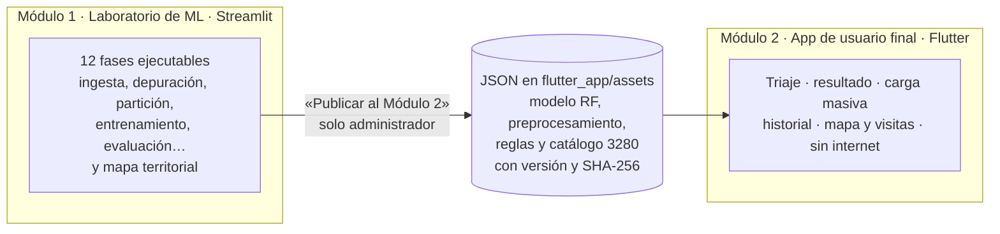

# MATERNA — Sistema de Alerta Temprana de Riesgo Materno-Perinatal

**Zonas dispersas y comunidades indígenas de La Guajira y Cesar**
Proyecto de aula · Inteligencia Artificial · Ingeniería de Sistemas, 7.º semestre · Universidad Popular del Cesar (UPC) · 2026

Equipo: Anyelin Cecilia Ospino Rueda · Duan Andrés Pineda Corrales · Rigoberto Márquez Fernández
Docente: Tony Jiménez

> ⚠️ **Prototipo académico.** El modelo se entrenó con un dataset **sintético** (1.200 gestantes) que el equipo calibró con proporciones del DANE y del INS. No contiene historias clínicas reales y **no debe usarse para tomar decisiones clínicas.** Las métricas miden cuánto reproduce el sistema el etiquetado sintético, no su desempeño clínico.

---

## 1. ¿Qué hace?

Clasifica a una gestante en **Bajo, Medio o Alto Riesgo** obstétrico a partir de datos que se pueden tomar en un puesto de salud rural: edad, semanas de gestación, controles previos, presión arterial, frecuencia cardiaca fetal, glucosa, proteinuria en tira y convulsiones. El sistema es **híbrido** y decide en este orden:

1. **Regla crítica** (`src/clinical_rules.py`): PAS ≥ 160, PAD ≥ 110, convulsiones o proteinuria ≥ ++ → Alto Riesgo.
2. **Signo de alarma de la Resolución 3280** (cefalea intensa, visión borrosa, tinnitus, dolor epigástrico, sangrado genital, fiebre o disminución de movimientos fetales) → Alto Riesgo.
3. Si no hay ninguno, decide el **Random Forest** (300 árboles), elegido en validación frente a la Regresión Logística (línea base) y la SVM.

## 2. Arquitectura: dos módulos independientes pero integrados



- **Módulo 1 · Laboratorio de ML** (`app_demo.py`, `paginas/`, `src/`). Para el docente, el equipo y el médico auditor. Cada fase del ciclo de vida se **ejecuta** en el aplicativo: carga masiva y generador sintético, depuración de datos crudos, partición parametrizable, parametrización de los tres modelos, entrenamiento en vivo con versiones, evaluación con interpretación de métricas, curvas de aprendizaje, nuevo patrón manual y **mapa territorial** (georreferenciación, ver abajo). La lista de chequeo del ciclo de vida es un documento interno del equipo (`src/lista_chequeo.py`). Roles: **administrador** (todo, incluido publicar) y **médico auditor** (audita e ingiere archivos; no entrena ni publica).
- **Módulo 2 · App de usuario final** (`flutter_app/`). Para el personal de salud en territorio. Un solo código para Android y web, **sin internet**: cuentas con usuario y PIN, triaje por pasos, resultado Alto/Medio/Bajo con motivo y conducta sugerida, carga masiva de archivos de la IPS priorizada (documentos seudonimizados con HMAC-SHA256), historial local en SQLite, **ubicación para la visita** (municipio, ranchería, vereda o resguardo; GPS solo con consentimiento) y pestaña **Mapa y visitas** con la lista de visitas priorizada, modo oscuro y ajustes de accesibilidad.
- **Integración.** Solo por los JSON que publica el Módulo 1. El motor en Dart reproduce a scikit-learn con **diferencia cero** (200 casos del modelo, 160 de alertas y la carga masiva de ejemplo). El modelo en uso (v1) solo cambia con «Publicar al Módulo 2»; los entrenamientos del laboratorio crean versiones nuevas en `experimentos/`.

### Georreferenciación: encontrar a las gestantes en territorio

En las comunidades indígenas de La Guajira y el Cesar es difícil ubicar a las gestantes (lugares dispersos y razones culturales). El mapa ayuda a encontrarlas y a priorizar las visitas. **La ubicación nunca es una variable del modelo**: no cambia el resultado ni las métricas.

- **Módulo 1 · «Mapa territorial»** (menú *Transversal*, enlace desde la fase 03): mapa por municipio coloreado por % de Alto Riesgo y mapa de concentración (un círculo por nivel en cada lugar, del tamaño de las gestantes; Alto encima), con filtros por departamento y nivel, tablas con las mismas cifras y una prueba que verifica que coinciden con el dataset.
- **Módulo 2 · «Ubicación para la visita»** (paso 3 del triaje, opcional): municipio, ranchería, vereda o resguardo, distancia aproximada a la cabecera (referencia de la IPS más cercana) y referencia comunitaria (un rol y un apodo, no un nombre completo). **Pestaña «Visitas»**: mapa de concentración y lista de visitas pendientes por prioridad (riesgo y último contacto) o por recorrido (lo más cercano primero dentro de cada nivel), con «Visitada» y «No la encontramos». También hay mapa en el historial y en el resultado de la carga masiva (por municipio).
- **Datos** (`data/geo/`, fuente en `data/geo/FUENTE.md`): límites de los 40 municipios y sus cabeceras **reales** (DANE, Marco Geoestadístico Nacional 2024); puntos de concentración y ubicaciones de las 1.200 gestantes **sintéticos** (semilla 42), rotulados así en el mapa. No se usan lugares reales como puntos para no asignarles riesgos inventados a comunidades reales.
- **Sin internet**: los mapas dibujan solo límites y puntos (ECharts en el laboratorio; flutter_map sin teselas en la app), sin mapa de calles.
- **Privacidad**: cada ubicación va solo con la evaluación y su código anónimo; tres niveles de detalle (municipio, lugar, GPS exacto). El GPS exacto exige el consentimiento registrado y una cuenta de médico o enfermería; la base local lo hace cumplir y solo entrega las coordenadas a esos roles. El mapa no muestra la etnia.
- **Regenerar**: `python -m src.georreferencia sinteticos` (mismo resultado con la misma semilla) y `python -m src.georreferencia app` (copia los archivos a `flutter_app/assets/geo/`; una prueba verifica que sean idénticos).

Pipeline de entrenamiento (todo lo que aprende de los datos se ajusta **solo** con entrenamiento o con cada fold):

```
CSV crudo ─► limpieza estructural ─► partición estratificada 70/15/15 (parametrizable en el Módulo 1)
                                          │
              train ──► [ imputación estratificada ─► RobustScaler + One-Hot ─► SMOTE | class_weight ─► modelo ]
                         └──────────────── GridSearchCV, 5-fold estratificado ─────────────────┘
              val   ──► selección del modelo del sistema híbrido
              test  ──► evaluación final (una sola vez)
```

## 3. Estructura del repositorio

```
MATERNA/
├── app_demo.py                      # Módulo 1: consola Streamlit (inicio de sesión y laboratorio)
├── paginas/                         # Laboratorio de las 12 fases, Triaje (Módulo 2) y variables 3280
├── src/                             # Preprocesamiento, modelos, reglas, evaluación, ingesta 3280,
│                                    # seudonimización, generador, experimentos, exportación a JSON…
├── config/variables_3280.json       # Catálogo único de 71 variables de la Res. 3280 y su decisión
├── data/raw/                        # Dataset sintético de 1.200 gestantes
├── data/geo/                        # Límites y cabeceras del DANE; puntos y ubicaciones sintéticos (mapa)
├── models/                          # Modelos oficiales de la Fase 2 (.joblib) y metadatos
├── reports/metrics/ y figures/      # Métricas, experimentos, auditoría de sesgos y figuras
├── notebooks/                       # EDA (Fase 1, corregido) y modelado (Fase 2)
├── tests/                           # 358 pruebas de Python (10 en Chrome)
├── flutter_app/                     # Módulo 2: app Flutter (lib/, test/ con 459 pruebas, assets/ con los JSON y geo/)
├── docs/                            # Documento técnico de la Fase 2
└── .streamlit/                      # Configuración; secrets.toml.example como plantilla de usuarios
```

No se versionan: `experimentos/` (versiones y registro del laboratorio), `data/salidas/` (ingestas seudonimizadas), `.streamlit/secrets.toml` (usuarios y sal) ni las bases SQLite locales.

## 4. Instalación y ejecución

### Módulo 1 · Laboratorio (Python 3, Windows/Linux/Mac)

```bash
python -m venv .venv
# Windows: .venv\Scripts\activate   ·   Linux/Mac: source .venv/bin/activate
pip install -r requirements.txt

# Usuarios: copie .streamlit/secrets.toml.example como .streamlit/secrets.toml, cambie MATERNA_SAL y cree el administrador
python -m src.autenticacion crear-usuario admin --rol administrador --nombre "Administrador"

streamlit run app_demo.py          # http://localhost:8501
```

Los modelos oficiales vienen en `models/`, así que el laboratorio funciona sin reentrenar. Para regenerar las cifras de la Fase 2: `python -m src.data_preprocessing`, `python -m src.train_models` (~2 min) y `python -m src.evaluate`. Todo es reproducible con la semilla 42.

### Módulo 2 · App (Flutter)

```bash
cd flutter_app
flutter pub get
flutter run -d chrome                          # probar en el navegador
flutter build apk --release                    # Android: build/app/outputs/flutter-apk/app-release.apk
flutter build web --no-web-resources-cdn       # web que no descarga nada de internet
```

La app trae el modelo en `flutter_app/assets/`; si el administrador publica un modelo nuevo desde el Módulo 1, los teléfonos lo reciben al **recompilar** la app. Se probó en un Xiaomi con Android 16.

### Pruebas

```bash
pytest                             # 358 pruebas de Python, incluidas 10 en Chrome real (requiere Google Chrome)
pytest -m "not e2e"                # 348, sin navegador
cd flutter_app && flutter test     # 459 pruebas de Dart (paridad, motor, pantallas, base local, mapa y visitas…)
```

## 5. Resultados (conjunto de prueba, n = 180, de los cuales 23 son Alto Riesgo)

| Sistema | Accuracy | F1-macro (IC 95 %) | ROC-AUC OvR | Recall Alto (IC 95 %) | FN Alto | Costo clínico* |
|---|---|---|---|---|---|---|
| Regresión Logística (baseline) | 0,722 | 0,724 [0,64–0,79] | 0,854 | 0,870 [0,70–1,00] | 3 | 99 |
| SVM RBF calibrado | 0,856 | 0,846 [0,78–0,90] | 0,961 | 0,783 [0,59–0,94] | 5 | 54 |
| Random Forest | 0,961 | 0,943 [0,89–0,98] | 0,988 | 0,870 [0,71–1,00] | 3 | 19 |
| Híbrido (RL + reglas) | 0,733 | 0,742 [0,67–0,80] | 0,864 | 0,957 [0,85–1,00] | 1 | 89 |
| Híbrido (SVM + reglas) | 0,878 | 0,886 [0,83–0,93] | 0,972 | 0,957 [0,85–1,00] | 1 | 34 |
| **Híbrido (Random Forest + reglas)** | **0,972** | **0,963 [0,92–0,99]** | **0,998** | **0,957 [0,86–1,00]** | **1** | **9** |

\*Matriz de costo ilustrativa que penaliza la subestimación del riesgo (Alto→Bajo = 10, Alto→Medio = 5, Medio→Bajo = 3; la sobreestimación cuesta 1–2). Ningún sistema clasificó un Alto Riesgo como Bajo.

- La sensibilidad es del **100 % solo en los casos con signo crítico** (14 de 14 en prueba; 89 de 89 en el dataset). El recall global de Alto es 0,957, no 1,00.
- **Sin signos críticos** (166 casos de prueba donde no actúa ninguna regla): Random Forest F1-macro 0,932; SVM 0,847; Regresión Logística 0,673.
- Validación cruzada (5-fold, entrenamiento), F1-macro: Random Forest (sin límite de profundidad, 50 % de variables por división, SMOTE) 0,932 ± 0,017; SVM RBF (C = 100, γ = scale, class_weight) 0,861 ± 0,011; Regresión Logística (C = 10, class_weight) 0,750 ± 0,013. Las 166 configuraciones están en `reports/metrics/experimentos_cv_completo.csv`.
- El escalamiento por signos de alarma de la Res. 3280 no cambia estas cifras: el dataset sintético no tiene esas variables.

**Escalabilidad** (Módulo 1, fase 04, Random Forest, Intel Core i5-8300H y 15,8 GB de RAM): 5.000 registros se cargan en 0,04 s, se depuran en 0,15 s y entrenan en 1,6 s; 30.000 registros, en 0,15 s, 0,34 s y 7,3 s.

## 6. Decisiones técnicas y correcciones

| Tema | Decisión | Motivo |
|---|---|---|
| SMOTE | Dentro de cada fold (`imblearn.Pipeline`) | Aplicarlo antes de la validación cruzada filtraría información sintética de los folds de validación. |
| SMOTE vs. `class_weight` | Se comparan como alternativas en cada modelo (gana SMOTE en RF y `class_weight` en SVM y RL) | Usarlos juntos compensaría el desbalance dos veces. |
| Random Forest como modelo principal | Se agregó después de las pruebas de coherencia clínica | El SVM clasificaba como Bajo Riesgo casos con un solo factor de riesgo y extrapolaba fuera de rango. Los árboles representan umbrales de forma nativa. |
| Probabilidades del SVM | `CalibratedClassifierCV` (Platt) | `SVC(probability=True)` está deprecado en scikit-learn 1.9. |
| Imputación | Mediana por **área × trimestre** + indicador `*_no_disponible` | Lo definió la Fase 1; con municipio × edad había estratos de una sola gestante. |
| Variables demográficas | Etnia, municipio y departamento **no** entran al modelo | No lo mejoran en la ablación (RF 0,932 → 0,930) y evitan que la identidad étnica funcione como *proxy* de riesgo. Se usan para auditar sesgos. |
| Datos de la IPS | Ingesta con la plantilla 3280, filtro de variables y seudonimización HMAC-SHA256 con sal propia | Ley 1581 de 2012: el documento nunca se guarda. Los archivos de la Res. 4505 recibidos (recién nacidos, sin variables maternas) **no se usan**. |
| Módulo 2 sin servidor | El modelo viaja como JSON y la app lo ejecuta en el dispositivo | Coherente con el objetivo offline; la API FastAPI de la propuesta inicial no fue necesaria. La sincronización es simulada. |
| Lo oficial no se toca | Los entrenamientos del laboratorio crean versiones nuevas | El modelo en uso (v1) solo cambia con «Publicar al Módulo 2» (administrador). |

Correcciones a la Fase 1 (detalle en el notebook de EDA): el EDA entregado analizaba el dataset UCI y no el propio; en la glucosa los nulos **no** se concentran en lo rural (cabecera 14,2 %, rural 12,6 %), en la FCF sí (6,0 % y 8,4 %); se elimina la columna vacía `Unnamed: 16`; y la cifra 76,9 citada para La Guajira es el percentil 75 nacional de 2023 (la razón de La Guajira en 2023 fue 94,1 según el INS).

## 7. Limitaciones, ética y sesgos

- **Etiquetas sintéticas por reglas.** Las 89 gestantes con signos críticos están todas etiquetadas como Alto Riesgo, porque las etiquetas se generaron con esos umbrales. Las métricas miden la capacidad de reproducir el etiquetado, no el desempeño clínico, y parte de la ventaja del Random Forest puede achicarse con datos reales.
- **Brecha por subgrupo.** El recall de Alto Riesgo en el área rural dispersa es 0,88 frente a 0,94 en cabecera. El subgrupo más bajo es la atención por auxiliar de enfermería (0,64, con solo 11 casos de Alto Riesgo). Ver `reports/metrics/auditoria_subgrupos.csv`.
- **Umbrales por validar.** La proteinuria ≥ ++, los signos de alarma que elevan el triaje y la conducta sugerida deben validarse con un especialista en ginecobstetricia. Con FCF 60 o glucosa 300 el modelo da solo Riesgo Medio; esos umbrales debe definirlos un especialista.
- **Seguridad local.** La base del teléfono no está cifrada; el PIN protege el acceso casual, no los archivos.
- **Ubicaciones.** Las del dataset y los puntos de concentración son sintéticos; solo los límites y las cabeceras son reales. La distancia a la cabecera es en línea recta y sirve solo como referencia: no hay rutas por vías.
- **Incertidumbre.** Con 23 casos de Alto Riesgo en prueba, los intervalos de confianza son amplios.
- **Herramienta de apoyo.** No reemplaza el juicio clínico; la decisión final es del profesional de salud.

## 8. Trabajo futuro

Validación con historias clínicas reales y anonimizadas mediante una alianza con una ESE/IPS · cierre de las brechas rural y de auxiliares con ajuste de umbral sobre datos reales · sincronización real con un servidor de la IPS · cifrado de la base local · incorporar al modelo las variables de la Res. 3280 que hoy solo generan alertas · usar una lista oficial de rancherías y resguardos (con las comunidades) y la ubicación real de las IPS para la georreferenciación.

## 9. Flujo de trabajo con Git

- Rama `main` estable; una rama por bloque (`fase3/…`) integrada mediante *pull request*.
- Mensajes de commit con prefijo: `feat:`, `fix:`, `docs:`, `test:`, `chore:`.
- Los tres integrantes aparecen como autores de sus commits; el historial de `git log` es la evidencia de trabajo incremental que pide la rúbrica.
